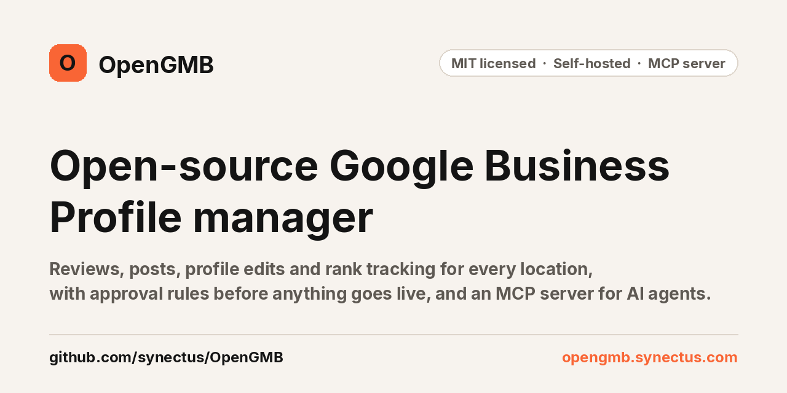
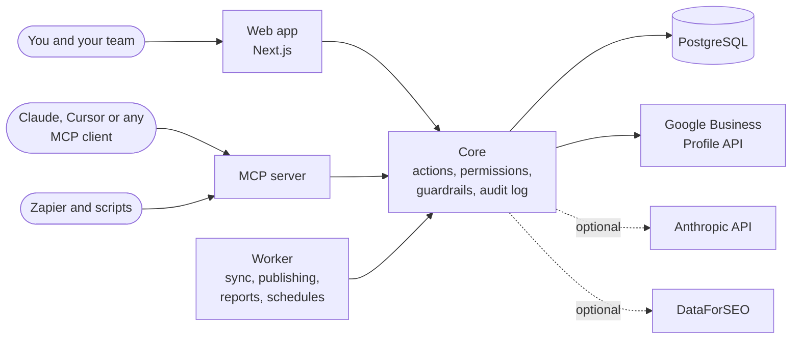

<p align="center">
  <a href="https://opengmb.synectus.com/open-source">
    
  </a>
</p>

<p align="center">
  <a href="LICENSE"></a>
  <a href="https://github.com/synectus/OpenGMB/actions/workflows/ci.yml"></a>
  <a href="https://github.com/synectus/OpenGMB/stargazers"></a>
  <a href="https://opengmb.synectus.com/docs/mcp"></a>
  <a href="SETUP.md"></a>
  
  
</p>

<p align="center">
  <a href="https://opengmb.synectus.com"><b>Website</b></a> ·
  <a href="https://opengmb.synectus.com/docs"><b>Docs</b></a> ·
  <a href="SETUP.md"><b>Self-host guide</b></a> ·
  <a href="https://opengmb.synectus.com/docs/mcp/tools"><b>MCP tools</b></a> ·
  <a href="https://opengmb.synectus.com/roadmap"><b>Roadmap</b></a> ·
  <a href="https://opengmb.synectus.com/pricing"><b>Hosted version</b></a>
</p>

# OpenGMB

OpenGMB manages Google Business Profiles for local businesses and the agencies that run them. Reviews, review replies, posts, profile edits, performance, reports and Maps rank tracking, for every location, in one place.

Two things make it different. Every reply, post and profile edit passes a set of rules and waits for a person to approve it before Google sees it. And every action in the app is also an MCP tool, so Claude, Cursor or any MCP client can do the routine work while you keep the final say.

This repository is the **community edition**: MIT licensed, self-hosted with Docker Compose, your own keys, one owner login for as many clients and locations as you need. It talks to Google only through the official Business Profile API.

<p align="center">
  
</p>

## Why we built it

We run an SEO agency and manage Google Business Profiles for clinics and local businesses. The tools we paid for charged per location, so the bill grew with every client before any work got done. And when we tried AI for replies and posts, we wanted it to draft the routine work while a person still signed off on everything that went live.

So we built the tool we wanted, used it for our own work, and opened the core.

## What it does

<table>
  <tr>
    <td width="50%" valign="top">
      
      <b>Posts</b><br />
      Write, schedule and approve posts for one location or many. A calendar shows what is scheduled, published or made directly on Google.
    </td>
    <td width="50%" valign="top">
      
      <b>Reviews</b><br />
      One inbox for every location's Google reviews. Assign them, add internal notes, and draft replies yourself, with templates or with AI.
    </td>
  </tr>
  <tr>
    <td width="50%" valign="top">
      
      <b>Profile health and edits</b><br />
      A health score with the checks behind it. Edit hours, categories and services across many locations in one change, and catch edits made outside OpenGMB.
    </td>
    <td width="50%" valign="top">
      
      <b>Performance and reports</b><br />
      Calls, website clicks, direction requests and impressions per location, search keywords by month, and reports you can share with a client.
    </td>
  </tr>
</table>

Also in the community edition:

- **Rank tracking** on a geo-grid around each location, next to its competitors, with your own DataForSEO account.
- **AI drafts** for replies, posts and descriptions with your own Anthropic key. No credits, no markup.
- **Review requests** with tracked links, QR codes and public location pages, and no review gating.
- **Approvals inbox**, location groups, white-label branding on reports.
- **REST API (v1)**, outgoing webhooks, and the source of the Zapier app.
- **Two-factor sign-in** (required) and an append-only, hash-chained audit log.

## Built for AI agents

The MCP server exposes around 250 tools, one for every action in the app: list reviews, draft and submit replies, schedule posts, edit hours, pull performance, run a health check, and more. Writes go through the same guardrails and approvals as the web app.

Create a token in **Settings → API tokens** (read only, or read and write), then add the server to your client. For Claude Code:

```sh
claude mcp add --transport http opengmb https://your-mcp-host/mcp \
  --header "Authorization: Bearer sgmb_your_token"
```

Then ask in plain words:

> Draft replies for this week's 1- and 2-star reviews at every location, and put them in the approval queue.

> Which locations lost the most calls last month compared with the month before?

> Schedule a holiday hours post for all dental clients for Friday, and send it for approval.

A human-in-the-loop token can draft and submit, but it cannot approve or publish. Every tool, with its inputs and the permission it needs, is listed at [opengmb.synectus.com/docs/mcp/tools](https://opengmb.synectus.com/docs/mcp/tools).

## Nothing goes live without a person

| What | Rule |
| --- | --- |
| Posts and profile edits | Always need a person's approval |
| Replies to 1 to 3 star reviews | Always need a person, never published automatically |
| Replies to 4 and 5 star reviews | Need a person, unless the owner turns on auto-approve for that client |
| Every reply, post and edit | Checked by guardrail rules first: links, emails, phone numbers, offers, bad hours, banned words. Blocks cannot be overridden; warnings must be acknowledged |
| Healthcare and law firm clients | Extra rule packs (HIPAA-style checks for names, clinical terms and dates; legal ethics) |

The rules run again just before anything is sent to Google.

## Quick start

You need Docker Engine 24 or newer with the Compose plugin, about 4 GB of free RAM while the images build, and a public HTTPS hostname if you want Google sign-in.

```sh
git clone https://github.com/synectus/OpenGMB.git
cd OpenGMB/deploy/selfhost
cp .env.example .env     # set OWNER_EMAIL and OWNER_PASSWORD; the comments explain every value
docker compose up -d --build
```

Open <http://localhost:8080> and sign in with the owner email and password. Two-factor sign-in is required, so have an authenticator app ready and keep the backup codes it shows.

The Google client starts in **mock mode**: under **Settings → Google**, press "Use the sample Google account" to import sample locations and click through everything without any Google keys. Going live needs Google's approval of Business Profile API access for your own Google Cloud project, which you request yourself and which can take a few days.

[SETUP.md](SETUP.md) covers every step: ports, email, Google, backups and upgrades. The same guide is online at [opengmb.synectus.com/docs/self-hosting](https://opengmb.synectus.com/docs/self-hosting).

## How it fits together



Every surface (web, MCP, REST, worker) runs the same actions through one executor, so permissions, guardrails and the audit log apply the same way no matter who or what makes the change.

| Path | What |
| --- | --- |
| `apps/web` | The Next.js app |
| `apps/mcp` | The MCP server (Streamable HTTP) and REST API |
| `apps/worker` | Background jobs: review sync, publishing, reports, schedules, Pub/Sub push |
| `packages/core` | Auth, tenancy, the action registry, the Google client, guardrail rules, the audit log |
| `packages/db` | Drizzle schema and migrations |
| `deploy/selfhost` | The self-host stack (Docker Compose). Use this to run OpenGMB |
| `integrations/zapier` | The Zapier app source |

The `docker-compose.yml` at the repository root is only a development Postgres for contributors.

## Community edition or hosted

| | Community edition (this repo) | [Hosted OpenGMB](https://opengmb.synectus.com) |
| --- | --- | --- |
| Price | Free, MIT | $10 a month per account, as usage credit |
| Who runs it | You, on your server | We do |
| Google Cloud project and API approval | Yours | Ours |
| Clients and locations | Unlimited | Unlimited |
| Reviews, posts, edits, reports, rank tracking | Yes | Yes |
| MCP server, REST API, webhooks | Yes | Yes |
| AI | Your Anthropic key | Included, paid from credit |
| Teams and roles | One owner login | Yes |
| Client portal with your branding | No | Yes |
| Custom domains | No | Yes |

If you would rather not run servers or wait for Google's API approval, the hosted version gives you $0.50 of trial credit with no card.

## Roadmap

What we are working on and what comes next is public at [opengmb.synectus.com/roadmap](https://opengmb.synectus.com/roadmap). Ideas and bug reports are welcome as GitHub issues.

## Contributing

Pull requests are welcome. Read [CONTRIBUTING.md](CONTRIBUTING.md) first: commits need a DCO sign-off, and accepted changes are merged in our main repository and then synced here, with credit to you. Report vulnerabilities privately, as described in [SECURITY.md](SECURITY.md).

## License and trademarks

The code is released under the [MIT license](LICENSE). Third-party notices are in [THIRD_PARTY_NOTICES.md](THIRD_PARTY_NOTICES.md).

The license covers the code, not the OpenGMB name or logo, which are trademarks of Synectus Private Limited. A fork needs its own name and logo. See [TRADEMARKS.md](TRADEMARKS.md).

OpenGMB is made by [Synectus](https://synectus.com). It is not affiliated with or endorsed by Google. Google Business Profile is a trademark of Google LLC.

## Star history

<a href="https://star-history.com/#synectus/OpenGMB&Date">
  
</a>
